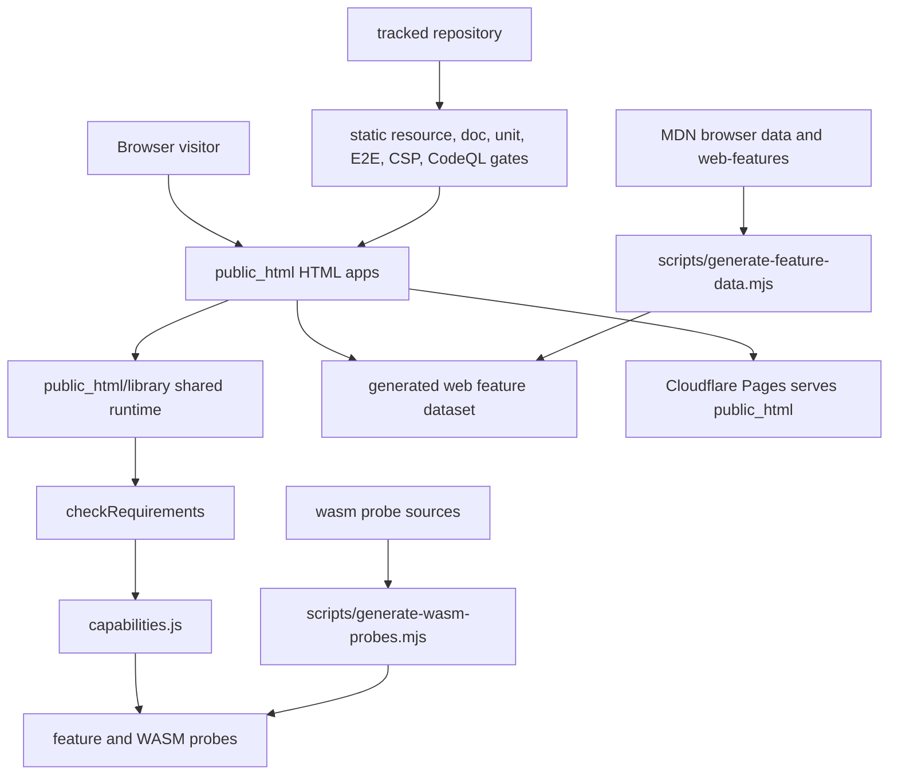

# Architecture

The production deployment is a static file tree. There is no production build step.

## Data flow

The portal links to each app. Apps load the shared runtime and same-origin generated data. Capability checks are read-only and do not trigger permission prompts. `checkRequirements` evaluates required and optional IDs before app-specific use. Static generators update checked-in data, capability documentation, and probe artifacts during development/CI; Cloudflare Pages serves the committed files directly.

## Source and generated files

Hand-written sources live in `public_html/`, `scripts/`, `wasm/`, and `tests/`. Generated data is under `public_html/library/data/`, generated WASM probe modules are under `public_html/library/wasm/probes/`, and the capability reference is `docs/capability-reference.md`. Edit their sources and regenerate outputs; never patch generated content alone.
